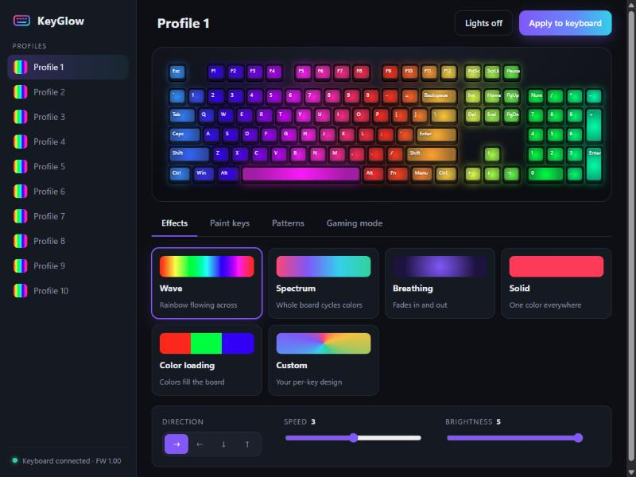

# KeyGlow

A friendly, open-source lighting app for the **HyperX Mars Gaming Keyboard**
(USB ID `0951:16C6`), the full-size RGB board that HyperX Genesis supports.



## Features

- **Built-in effects:** Wave, Spectrum, Breathing (up to 5 colors), Solid and Color loading, each with speed, brightness and direction controls.
- **Paint keys:** brush, eraser, eyedropper and fill for your own per-key design, with designs you can save and reuse.
- **21 patterns:** Rainbow, Water ripple, Sunset, Ocean, Aurora, Synthwave, Cyberpunk, Galaxy, Fire, Lava, Matrix, Ice, Forest, Candy, Gamer WASD, Typing zones, Brasil and more.
- **10 profiles:** switching profiles writes that profile to the keyboard immediately.
- **Gaming mode:** blocks the Windows key, Alt+Tab and/or Alt+F4 while KeyGlow runs.
- **Live preview:** an animated on-screen keyboard shows each effect before you apply it.
- **Runs without KeyGlow:** everything is stored on the keyboard, so your lighting keeps working when KeyGlow is closed (gaming mode is the exception).

## Download

Grab `KeyGlow.exe` from the [Releases](../../releases) page and run it. There's
no installer. It needs Windows 10/11 with the Microsoft Edge WebView2 runtime,
which ships with Windows 11.

## Build from source

```powershell
git clone <this repo>
cd keyglow
powershell -ExecutionPolicy Bypass -File build.ps1   # runs tests, then builds dist\KeyGlow.exe
```

To run without building:

```powershell
python -m venv .venv
.venv\Scripts\pip install -r requirements.txt
.venv\Scripts\python keyglow_app.py
```

## Good to know

- Settings live in `%APPDATA%\KeyGlow\settings.json`.
- Each **Apply** writes to the keyboard's flash memory. That's fine for normal
  use, so KeyGlow only writes when you click Apply or switch profiles. It never
  streams animations.
- **No reactive or ripple effects:** this keyboard's firmware has none built in,
  and faking them would mean constant flash writes. The *Water ripple* pattern
  gives you the look as a static design.
- **Key remapping and macros** from the original software aren't included yet.
  See [docs/PROTOCOL.md](docs/PROTOCOL.md) for what's known.

## How it works

KeyGlow talks to the keyboard with HID feature reports, the same way the vendor
software does. The protocol is documented in [docs/PROTOCOL.md](docs/PROTOCOL.md).

## Disclaimer

KeyGlow is an independent project. It isn't affiliated with or endorsed by
HyperX, HP or Kingston. "HyperX" is a trademark of its owner and is used here
only to say which hardware this works with. Use at your own risk.

## License

MIT, see [LICENSE](LICENSE).
